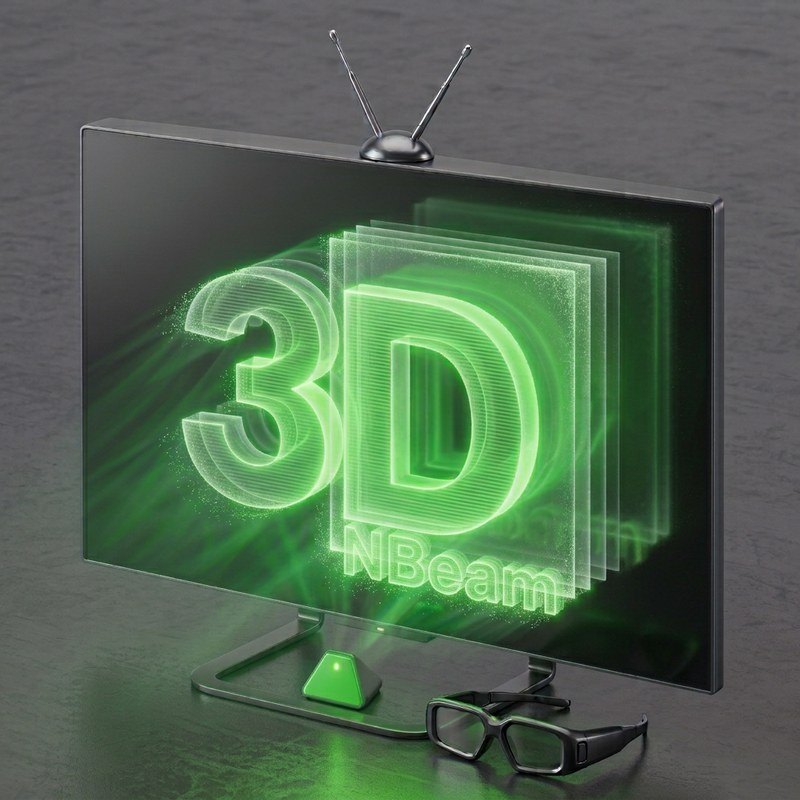

# Nbeam 3D Vision

**Version 1.1.0 — par anto1444, 2026**

**Ressortez vos vieux kits : la résurrection de l'émetteur NVIDIA 3D Vision est là !** Nbeam pilote directement l'émetteur USB pour créer un flux 3D séquentiel synchronisé avec votre écran, sans pilote d'affichage « 3D Vision » ni écran certifié. La 3D active fonctionne donc **partout sur le bureau, sur n'importe quel écran, même en fenêtré**, en capturant un programme précis. Avec la 3D par IA, plus besoin de jeux compatibles 3D Vision : le rendu par IA fonctionne sur n'importe quel jeu, même les jeux multijoueurs. Les **changements de profil et les réglages des lunettes sont instantanés** : on règle en direct, et chaque jeu retrouve tout seul ses propres réglages.

Nbeam 3D Vision est une surcouche (overlay) Windows qui s'affiche par-dessus un jeu ou une vidéo et réunit, sur **n'importe quel écran** :

- le **BFI** et le **CRT Beam Simulator** pour supprimer le flou de mouvement d'un écran LCD/OLED rapide ;
- la **3D active** (lunettes NVIDIA 3D Vision ou émetteur Arduino) à partir d'un contenu 3D en côte à côte, haut/bas ou damier, avec ou sans les effets ci-dessus, ou depuis une image 2D grâce à l'IA ;
- des **profils** par jeu, chargés automatiquement.

> **Attention** — ce logiciel produit des images qui clignotent très vite. Prudence si vous êtes photosensible.

> **Attention — risque pour l'écran** : un écran trop lent peut **marquer temporairement la dalle** (rémanence) avec le BFI ou la simulation CRT. Utilisation **à vos risques et périls**.

## Avertissement au premier démarrage

Au tout premier lancement (quand le dossier `Profils` est créé), Nbeam affiche un avertissement.

## Prérequis

- Windows 10 (1903) ou 11, 64 bits, carte graphique DirectX 11 (RTX 3050 ou AMD équivalent recommandé).
- Écran : **100 Hz minimum** pour la 3D **ou** le BFI, **240 Hz ou plus** pour les deux ensemble. Idéal : un écran **OLED**, ou un LCD à temps de réponse rapide.
- 3D NVIDIA : l'émetteur USB et son pilote. 3D Arduino : un émetteur compatible sur un port COM.

## Démarrage rapide

1. Placez `Nbeam3DVision.exe` dans un dossier où il peut écrire.
2. Lancez-le : le dossier `Profils\` et le profil d'exemple `Defaut.ini` sont créés.
3. Dans le HUD, choisissez l'**écran de sortie** (votre écran rapide) et le nombre de **sous-images**, puis lancez votre jeu.

Principe : Nbeam **capture** l'écran ou la fenêtre d'un programme, applique l'effet puis **réaffiche** l'image en plein écran au rythme de l'écran de sortie. Les **sous-images** sont le nombre d'images affichées pour chaque image du contenu : sur 240 Hz, 4 sous-images = un contenu à 60 images/s.

## BFI simple

Insère des images noires entre les images du jeu.

- **Images claires** : nombre de sous-images qui montrent l'image (jamais plus que le nombre de sous-images). Moins d'images claires = mouvement plus net, mais moins lumineux et plus de scintillement.
- **Gain vs flou** : noirceur des images insérées. 1 = noir complet (BFI classique) ; plus bas, une partie de l'image reste visible (plus lumineux, moins de scintillement, un peu plus de flou).

## CRT Beam Simulator

Reproduit le balayage d'un tube cathodique : l'image est « dessinée » ligne par ligne sur les sous-images, avec une fin de persistance du phosphore. Le mouvement est net et plus doux que le BFI classique.

- **Gain vs flou** : compromis luminosité / flou. 1 = luminosité inchangée ; plus bas = moins de flou sur les zones sombres, au prix de la luminosité.
- **Gamma** : le gamma de votre écran (évite les bandes horizontales).
- **Direction du balayage**, **Mode ralenti** (pour observer la simulation), **Anti-rétention LCD** (évite la rétention d'image sur LCD), **Niveau de noir** (ce qui est plus sombre devient un noir pur ; utile sur OLED et en HDR).

> **Images en file à 0 (tearing) : déconseillé avec le BFI et le CRT.** La déchirure peut couper une image claire ou noire en deux et provoquer des bandes ou un scintillement irrégulier. Gardez une valeur de file de 1 ou plus, ou placez la ligne de tearing tout en haut de l'image (masquée) avec le contrôle du tearing.

### BFI adaptatif (Sous-images : Auto)

Quand un programme est capturé, le curseur **Sous-images** propose **Auto** (avant le 1). C'est le **BFI adaptatif** : Nbeam mesure en continu la cadence réelle du jeu et ajuste tout seul le nombre de sous-images (120 images/s sur 480 Hz → 4, 240 images/s → 2). Ses atouts :

- l'effet **reste net et régulier** même quand le jeu change de cadence (cinématique en 30 images/s, menu, chute d'images) : plus besoin de choisir un réglage par jeu ni de le corriger à la main ;
- si la cadence tombe sous un **seuil réglable**, le BFI est doublé ou coupé pour éviter un scintillement lent et fatigant ;
- la réactivité se règle avec l'**intervalle de détection**.

> **Attention** — pour un meilleur résultat, privilégiez toujours une cadence de jeu qui **divise exactement la fréquence de l'écran** (60, 80, 120 ou 240 images/s sur 480 Hz, par exemple). Sinon (73 images/s sur 480 Hz…), le nombre de sous-images ne tombe pas juste et le jeu paraîtra saccadé.

Auto n'est pas disponible avec la 3D (les sous-images suivent alors l'émetteur).

### Tampon d'image

Le **tampon d'image** garde quelques images du jeu d'avance pour **lisser un jeu à cadence irrégulière**, au prix d'un peu de latence (uniquement avec la capture d'un programme). 0 = désactivé, 1 à 5 = nombre d'images d'avance. En **Auto**, Nbeam adapte lui-même la taille.

Avec les **sous-images sur une valeur fixe** (pas en Auto), le tampon gère aussi un jeu qui tourne à un **diviseur de la cadence du contenu** : pour un contenu à 120 fps et un jeu à 60, 40, 30 ou 15 fps, chaque image du jeu est affichée exactement 2, 3, 4 ou 8 fois, régulièrement, au lieu d'une alternance irrégulière.

Avec la **2D vers 3D (IA)**, le tampon d'image fonctionne comme ailleurs. La synchronisation des cartes de profondeur est une option à part, le **Tampon de carte** (panneau 3D, sous « Afficher la carte de profondeur ») : le calcul de la profondeur prend du temps et la carte arrive en retard sur l'image ; coché, Nbeam mesure ce délai (affiché dans le panneau 3D) et retient chaque image jusqu'à ce que sa propre carte soit prête, pour que **la profondeur colle à l'image**. Il s'ajoute au tampon d'image (les deux délais se cumulent). Décoché, aucune synchronisation : pas de latence ajoutée, mais la profondeur peut être en retard sur les mouvements rapides.

## 3D active

- **Formats** : côte à côte (SBS), haut/bas (TB), damier, ou **2D vers 3D (IA)**.
- La bascule des yeux se fait à Hz de l'écran ÷ sous-images ; chaque œil reçoit la moitié. En 3D, les sous-images sont **liées à la fréquence de l'émetteur** (480 Hz et émetteur à 120 Hz → 4). La case **Auto** de la synchronisation détecte la fréquence de l'émetteur entre 80 et 165 Hz (hors de cette plage, rien ne se passe et l'émetteur reste éteint).
- Réglez d'abord **Sync Offset**, puis **Open Duration**, en regardant l'image à travers les lunettes, **avec les raccourcis clavier** (le HUD affiché fausse le rythme).
- Le **tearing** (option des images en file, 0 = tearing autorisé) donne la latence la plus basse en 2D ; le **contrôle du tearing** place la ligne de déchirure (0 = tout en haut, masquée).
- **Beam racing** (avec les images en file à 0) : Nbeam lit la position réelle du balayage de l'écran et n'envoie l'image que là où la déchirure ne se voit pas. BFI, 3D et image simple : juste avant le retour vertical (aucune déchirure visible). CRT Beam Simulator (balayage haut-bas ou bas-haut) : aussi au-dessus des bandes allumées, pour une latence plus basse. L'**avance du tearing** compense le délai d'envoi (augmentez-la si une déchirure apparaît en haut de l'image). Occupe un cœur du processeur ; nécessite un écran dont la position de balayage est lisible et rien par-dessus la fenêtre de Nbeam. Fonction expérimentale.

> **Images en file à 0 (tearing) : fortement déconseillé en 3D.** Le tearing perturbe l'alternance gauche/droite et provoque des images fantômes et du scintillement dans les lunettes. Nbeam affiche un avertissement en rouge si vous le choisissez avec la 3D active. Gardez une valeur de file de 1 ou plus.

**2D vers 3D (IA)** : un modèle de profondeur estime la profondeur de chaque pixel pour créer les deux vues. Il faut placer à côté de l'exe `onnxruntime.dll`, `onnxruntime_providers_shared.dll` et un modèle `.onnx` (ex. `model_fp16.onnx`) ; ces fichiers ne sont exigés que pour cette source ; l'**anti-halo** (jusqu'à 300 %) limite le débordement de la profondeur d'un objet sur le fond ; le **Tampon de carte** cale la profondeur sur l'image (voir Tampon d'image).

> **Ces fichiers ne sont pas fournis avec Nbeam** (pour des raisons de licence et de taille). `onnxruntime.dll` et `onnxruntime_providers_shared.dll` proviennent d'une version DirectML d'[ONNX Runtime](https://github.com/microsoft/onnxruntime/releases) (Microsoft, MIT) ; le modèle `.onnx` est un modèle d'estimation de profondeur à fournir vous-même, en respectant sa licence. Copiez ces trois fichiers à côté de `Nbeam3DVision.exe`. Sans eux, Nbeam fonctionne normalement : seule la source « 2D vers 3D (IA) » est indisponible.

## Raccourcis clavier et manette

Tous les raccourcis sont **entièrement personnalisables**, au clavier comme à la manette, dans la section **Raccourcis** du HUD :

- **Clavier** : cliquez sur un raccourci, puis appuyez sur la nouvelle combinaison (au moins Ctrl, Alt, Maj ou Windows ; Échap annule). Ils fonctionnent partout, même dans un jeu en plein écran.
- **Manette (XInput)** : cliquez sur le bouton « Pad » d'une action, maintenez ensemble les boutons voulus (gâchettes comprises) puis relâchez ; Retour arrière efface.
- Les actions couvrent l'affichage du HUD, le redémarrage, la sortie, l'inversion des yeux en 3D, les sous-images, les images claires, le Sync Offset et l'Open Duration, la désactivation des effets, la détection de profil et l'**ajout du programme au premier plan** (voir Profils).

Les raccourcis sont les mêmes pour tous les profils : changer de profil ne les modifie jamais.

## Profils

Un **profil** est un fichier `.ini` du dossier `Profils\` qui mémorise tous les réglages de rendu, d'affichage et de 3D. On en change depuis le HUD ou le menu de l'icône de notification.

Une **détection de profil** associe un programme (`.exe`) à un profil. Pour ajouter un programme, saisissez son nom d'exe, ou, depuis le programme lui-même, appuyez sur le raccourci **Ajouter le programme au premier plan** (Ctrl+Maj+P par défaut) : son exe est ajouté à la liste. Ensuite :

- quand le programme est détecté (fenêtre visible dans la barre des tâches, après un délai réglable), son profil est chargé, il est capturé et le HUD se réduit ;
- à sa fermeture, le profil précédent revient ;
- un même programme peut avoir jusqu'à 3 profils, un par écran ; celui de l'écran où se trouve sa fenêtre est choisi ;
- chaque écran peut avoir son propre **taux de rafraîchissement**, appliqué pendant la capture puis rétabli ;
- une détection peut être désactivée sans être supprimée.

## Tutos d'usage

**Un jeu 60 images/s sur un écran 240 Hz, sans flou** : créez un profil, choisissez le CRT Beam Simulator ou le BFI simple, 4 sous-images, plafonnez le jeu à 60 images/s, puis liez le `.exe` du jeu à ce profil dans « Détection de profil ».

**Un jeu en 3D (côte à côte)** : choisissez le format source SBS, l'émetteur de vos lunettes, puis réglez Sync Offset et Open Duration. En 3D, chaque œil reçoit la moitié des sous-images : visez 240 Hz ou plus pour garder du BFI/CRT en plus.

**3D sans crosstalk (fantômes entre les yeux)** : cumulez la 3D avec le BFI ou le CRT Beam Simulator. Choisissez le format source (ex. SBS) et l'émetteur, puis activez le CRT Beam Simulator ou le BFI simple avec au moins 2 sous-images par œil (visez 240 Hz ou plus : 4 sous-images donnent 2 images pour chaque œil). Les images noires ou le balayage CRT effacent l'image de l'œil précédent avant que l'autre œil s'ouvre, ce qui réduit fortement les doubles images. Ajustez ensuite Open Duration (plus court = moins de fantômes) et Sync Offset en regardant à travers les lunettes.

**Regarder une vidéo 2D en 3D** : choisissez « 2D vers 3D (IA) », puis réglez la force de la profondeur (2 à 4 % est confortable) et la convergence. Laissez **Tampon de carte** coché pour que la profondeur colle à l'image (la latence ajoutée n'a pas d'importance pour une vidéo) ; pour un jeu rapide, décochez-le si la latence gêne.

**Plusieurs écrans** : ajoutez une paire profil/écran par écran dans la détection ; Nbeam choisit celle de l'écran où se trouve le jeu.

**Latence minimale** : mettez les images en file à « 0 (tearing autorisé) » et réglez le contrôle du tearing pour cacher la déchirure en haut de l'image.

## Conseils

- Branchez un seul écran, ou faites tourner Nbeam sur le plus rapide.
- Plafonnez le jeu à la valeur « FPS contenu » du HUD.
- Si l'image saccade, augmentez la file d'images ou mettez le tampon d'image sur Auto.

## Crédits et remerciements

Nbeam 3D Vision repose sur le travail d'autres auteurs, un grand merci à eux :

- **[ShaderBeam](https://github.com/mausimus/ShaderBeam)** par **mausimus** (licence MIT) : la base de tout ce projet (capture, rendu, BFI, structure du logiciel).
- **[CRT Beam Simulator](https://github.com/blurbusters/crt-beam-simulator)** par **Mark Rejhon (Blur Busters)** et **Timothy Lottes** : l'algorithme et les shaders de simulation CRT ([article](https://blurbusters.com/crt)).
- **[Dear ImGui](https://github.com/ocornut/imgui)** par Omar Cornut et ses contributeurs : l'interface (HUD).
- **[Inter](https://rsms.me/inter/)** par The Inter Project Authors (licence SIL OFL 1.1) : la police du HUD.
- **[ONNX Runtime](https://github.com/microsoft/onnxruntime)** (Microsoft, MIT) et **[DirectML](https://github.com/microsoft/DirectML)** : l'inférence IA.
- **[Depth Anything V2](https://github.com/DepthAnything/Depth-Anything-V2)** : le modèle de profondeur pour la 2D vers 3D. Le modèle n'est **pas distribué** avec Nbeam : sa licence dépend de sa taille (la version Small est en Apache-2.0, les plus grandes sont en usage non commercial), vérifiez celle du modèle que vous utilisez.
- **[WibbleWobble](https://github.com/PHARTGAMES/WibbleWobbleCore)** (PHARTGAMES, GPL-3.0) : l'inspiration de la 3D active sur écran quelconque et de ses réglages (synchronisation, durée d'ouverture, inversion des yeux).
- **[mINI](https://github.com/metayeti/mINI)** de Danijel Durakovic (licence MIT) : la lecture et l'écriture des fichiers `.ini` des profils.
- **[NVAPI](https://github.com/NVIDIA/nvapi)** (NVIDIA, licence MIT) : les en-têtes qui permettent de plafonner le framerate d'un jeu par le profil du pilote NVIDIA.
- **[stb](https://github.com/nothings/stb)** de Sean Barrett (domaine public / MIT), livré avec Dear ImGui : rendu des polices.

Ajouts de Nbeam 3D Vision (3D active avec lunettes, profils et détection par programme, capture de processus, sortie « Processus », tampon d'image et tampon de carte, tearing, 2D vers 3D) : anto1444, 2026.

Nbeam 3D Vision est distribué sous licence MIT, comme ShaderBeam.

*Développé avec l'aide de Claude (Anthropic).*

*NVIDIA et 3D Vision sont des marques de NVIDIA Corporation, citées uniquement pour indiquer la compatibilité. Nbeam 3D Vision n'est ni affilié à NVIDIA, à Blur Busters, à WibbleWobble ni à ShaderBeam, ni approuvé par eux.*
