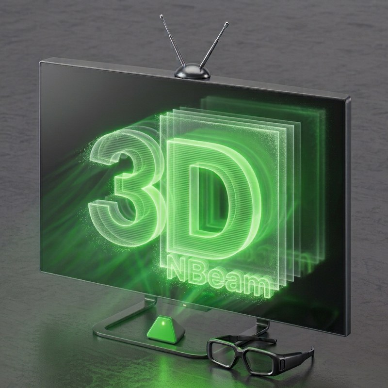

# Nbeam 3D Vision

**Version 2.4.0 — par anto1444, 2026**

> **English** — **Nbeam 3D Vision brings NVIDIA 3D Vision back to life on any monitor.** It is a free, open-source Windows overlay that drives the NVIDIA 3D Vision USB IR emitter (or an Arduino emitter) directly, so **active-shutter 3D glasses** work again on modern Windows 10 / 11 PCs **without the discontinued 3D Vision driver, without a certified 3D monitor and without a compatible game**: it works on the desktop, in windowed mode and in any game, multiplayer included.
>
> - **Stereoscopic 3D** from side-by-side (SBS), top-bottom (TB) or checkerboard content, or from any **2D game or video converted to 3D in real time by AI** (a depth-estimation model such as Depth Anything V2, run on the GPU with DirectML; ONNX Runtime and the model are not included, see below), with convergence and depth controls.
> - **Motion blur reduction** on fast LCD and OLED screens (120 to 480 Hz): **BFI (black frame insertion)** and the **CRT beam simulator** from Blur Busters, alone or together with 3D, with **BFI sync** for captured games (phase lock for lower latency, adaptive frame buffer for stability, or both) and **BFI auto** (SubFrames following the game frame rate).
> - **Can capture another capture overlay** similar to its own, such as **Lossless Scaling**: BFI, CRT or 3D are added on top of the picture that software has already scaled or generated.
> - **Per-game profiles** loaded automatically when the game's .exe is detected, separate desktop settings, live adjustment of the glasses (sync offset, open duration), a **motion test** with scrolling cars to compare settings and check eye inversion, hotkeys and gamepad support.
> - Requirements: Windows 10 (1903) or 11 64-bit, DirectX 11 GPU, a 100 Hz+ display for 3D or BFI (240 Hz+ for both). Download the latest version from the [Releases](https://github.com/anto1444/Nbeam3DVision/releases) page. The interface and the full guide below are in French (switch the interface to English in Application → Language / Langue).
>
> *Keywords: NVIDIA 3D Vision, 3D Vision emitter, 3D Vision Windows 11, 3D Vision without driver, active shutter glasses, stereoscopic 3D gaming, 2D to 3D conversion, SBS 3D, BFI, black frame insertion, CRT beam simulator, motion blur reduction, OLED, high refresh rate, ShaderBeam.*

**Ressortez vos vieux kits du placard : la résurrection de l'émetteur NVIDIA 3D Vision est là !** Nbeam pilote directement l'émetteur USB pour créer un flux 3D séquentiel synchronisé avec votre écran, sans pilote d'affichage « 3D Vision » ni écran certifié. La 3D active fonctionne donc **partout sur le bureau, sur n'importe quel écran, même en fenêtré**, en capturant un programme précis. Avec la 3D par IA, plus besoin de jeux compatibles 3D Vision : le rendu par IA fonctionne sur n'importe quel jeu, même les jeux multijoueurs. Les **changements de profil et les réglages des lunettes sont instantanés** : on règle en direct, et chaque jeu retrouve tout seul ses propres réglages.

Nbeam 3D Vision est une surcouche (overlay) Windows qui s'affiche par-dessus un jeu ou une vidéo et réunit, sur **n'importe quel écran** :

- le **BFI** et le **CRT Beam Simulator** pour supprimer le flou de mouvement d'un écran LCD/OLED rapide ;
- la **3D active** (lunettes NVIDIA 3D Vision ou émetteur Arduino) à partir d'un contenu 3D en côte à côte, haut/bas ou damier, avec ou sans les effets ci-dessus, ou depuis une image 2D grâce à l'IA ;
- des **profils** par jeu, chargés automatiquement quand le jeu est détecté (le bureau a ses propres réglages) ;
- un **mode fenêtre** : on règle tout dans une fenêtre normale (sa place et sa taille sont retenues), et les effets ne démarrent que quand un jeu détecté se lance ou quand on clique sur « Activer les effets » ;
- la capture **d'une autre surcouche de capture** semblable à la sienne, par exemple **Lossless Scaling** : Nbeam ajoute alors son BFI, son CRT ou sa 3D à l'image déjà mise à l'échelle ou générée par cet autre logiciel.

> **Attention** — ce logiciel produit des images qui clignotent très vite. Prudence si vous êtes photosensible.

> **Attention — risque pour l'écran** : un écran trop lent peut **marquer temporairement la dalle** (rémanence) avec le BFI ou la simulation CRT. Utilisation **à vos risques et périls**.

## Avertissement au premier démarrage

Au tout premier lancement (quand le dossier `Profils` est créé), Nbeam affiche un avertissement.

## Prérequis

- Windows 10 (1903) ou 11, 64 bits, carte graphique DirectX 11 (RTX 3050 ou AMD équivalent recommandé).
- Processeur : **4 cœurs / 8 threads minimum** (Intel Core i5 de 8e génération ou AMD Ryzen 3 3100), **6 cœurs / 12 threads recommandé** (Intel Core i5-10400 ou AMD Ryzen 5 3600 et plus récents). Nbeam garde un thread à haute priorité pour le rendu et un autre pour la synchro des lunettes, et le beam racing occupe un cœur pendant l'attente ; le jeu doit garder assez de cœurs libres. La 2D vers 3D (IA) tourne sur la carte graphique (DirectML) ; sur le processeur seul, elle demande un processeur bien plus puissant.
- Écran : **100 Hz minimum** pour la 3D **ou** le BFI, **240 Hz ou plus** pour les deux ensemble. Idéal : un écran **OLED**, ou un LCD à temps de réponse rapide.
- 3D NVIDIA : l'émetteur USB et son pilote. 3D Arduino : un émetteur compatible sur un port COM.

## Démarrage rapide

1. Placez `Nbeam3DVision.exe` dans un dossier où il peut écrire.
2. Lancez-le : le dossier `Profils\` est créé, avec le profil d'exemple `Defaut.ini` et les réglages du bureau `Bureau.cfg`.
3. Dans la fenêtre de Nbeam, choisissez l'**écran de sortie** (votre écran rapide) et le nombre de **sous-images**.
4. Cliquez sur **Activer les effets**, ou ajoutez votre jeu dans la configuration du profil : les effets démarreront tout seuls à son lancement.

Principe : Nbeam **capture** l'écran ou la fenêtre d'un programme, applique l'effet puis **réaffiche** l'image en plein écran au rythme de l'écran de sortie. Les **sous-images** sont le nombre d'images affichées pour chaque image du contenu : sur 240 Hz, 4 sous-images = un contenu à 60 images/s.

## Conseils

- **Pour de meilleurs réglages 3D, privilégiez toujours les raccourcis clavier ou le mini menu de l'émetteur** (molette et bouton) plutôt que le HUD à la souris : le pointeur visible peut provoquer une désynchronisation temporaire de la 3D.
- Branchez un seul écran, ou faites tourner Nbeam sur le plus rapide.
- Plafonnez le jeu à la valeur « FPS contenu » du HUD.
- Si l'image saccade, augmentez la file d'images ou choisissez Hybride ou Tampon d'image dans Synchro BFI.

## Mode fenêtre

Nbeam s'ouvre toujours dans une **fenêtre Windows normale** (déplaçable, redimensionnable), avec la même présentation que le HUD : bandeau, catégories à gauche, réglages au centre, barre du bas. On y fait tous les réglages **effets coupés** (rien n'est capturé).

- **Les effets démarrent** avec le bouton **Activer les effets** (en bas), le raccourci **Afficher / masquer les effets**, le menu de l'icône de notification, ou tout seuls quand un **programme détecté** se lance. La fenêtre disparaît et l'overlay s'affiche par-dessus l'écran.
- **Pendant que les effets tournent**, le HUD par-dessus l'écran fonctionne comme avant (son raccourci) ; son bouton du bas devient **Désactiver les effets**.
- **Les effets s'arrêtent** à la fermeture du programme détecté, avec **Désactiver les effets** ou avec le même raccourci ; la fenêtre revient (sans prendre le focus du jeu quand c'est le raccourci).
- **Place et taille** : quand on quitte Nbeam, la fenêtre retient sa position exacte, sa taille et si elle était agrandie ; elle revient pareille au prochain lancement (au centre si cet écran n'est plus branché).
- **Menu de l'icône de notification** (clic droit) : démarrer avec Windows, démarrer réduit, activer / désactiver les effets, **Redémarrer** et Quitter.
- **La croix** de la fenêtre la réduit si **Réduire au lieu de fermer** est coché (Application) : dans la zone de notification si cette option est cochée, les détections continuent. Décochée, la croix quitte Nbeam.
- La **taille de l'interface** se règle séparément pour la fenêtre et pour le HUD par-dessus l'écran (Apparence → Taille du HUD, dans le mode concerné).

## BFI simple

Insère des images noires entre les images du jeu.

- **Images claires** : nombre de sous-images qui montrent l'image (jamais plus que le nombre de sous-images). Moins d'images claires = mouvement plus net, mais moins lumineux et plus de scintillement.
- **Gain vs flou** : noirceur des images insérées. 1 = noir complet (BFI classique) ; plus bas, une partie de l'image reste visible (plus lumineux, moins de scintillement, un peu plus de flou).

## CRT Beam Simulator

Reproduit le balayage d'un tube cathodique : l'image est « dessinée » ligne par ligne sur les sous-images, avec une fin de persistance du phosphore. Le mouvement est net et plus doux que le BFI classique.

- **Gain vs flou** : compromis luminosité / flou. 1 = luminosité inchangée ; plus bas = moins de flou sur les zones sombres, au prix de la luminosité.
- **Gamma** : le gamma de votre écran (évite les bandes horizontales).
- **Direction du balayage**, **Mode ralenti** (pour observer la simulation), **Anti-rétention LCD** (évite la rétention d'image sur LCD), **Niveau de noir** (ce qui est plus sombre devient un noir pur ; utile sur OLED et en HDR).

> **Images en file à 0 (tearing) : déconseillé avec le BFI et le CRT.** La déchirure peut couper une image claire ou noire en deux et provoquer des bandes ou un scintillement irrégulier. Gardez une valeur de file de 1 ou plus, ou placez la ligne de tearing tout en haut de l'image (masquée) avec le contrôle du tearing.

### Présentation directe (expérimental)

Case sous « Images en file ». Cochée, Windows affiche Nbeam **directement à l'écran** au lieu de le mélanger d'abord avec le bureau : un peu **moins de latence** et un BFI **plus régulier**. Le rendu redémarre quand on la change ; c'est un réglage de profil.

- **Plus de clic à travers** : tant que le HUD est caché, Nbeam ne prend pas le focus, ignore les clics et cache le pointeur. La plupart des jeux 3D continuent de marcher normalement ; les jeux et menus qu'on utilise avec le pointeur Windows ne reçoivent plus les clics.
- Ça ne marche que si **rien ne s'affiche par-dessus** Nbeam (notifications, volume, overlays Discord ou Steam...).
- La ligne en dessous indique si Windows a accepté (*directe*) ou non (*composée par Windows*), et combien d'images sont arrivées en retard par minute. Comparez avec et sans l'option dans le même jeu.

### Synchronisation BFI

Le BFI fait clignoter l'image à un rythme fixe ; le jeu, lui, envoie ses images quand il peut. Le menu **Synchro BFI** choisit comment accorder les deux. Il n'apparaît que lorsqu'un **programme est capturé**, et il est **masqué en 3D** : le tampon d'image est alors toujours utilisé.

| Choix | En bref | Pour qui |
|---|---|---|
| **Aucune (déconseillé)** | Nbeam prend l'image du jeu quand son cycle commence. Simple, mais une image peut attendre presque un cycle entier. | Pour comparer. |
| **Calage de phase (meilleure latence)** | Nbeam observe quand les images du jeu arrivent et se cale dessus : chaque image est montrée presque aussitôt. | Jeux à cadence stable (plafonnée). |
| **Tampon d'image (meilleure stabilité)** | Nbeam garde une ou quelques images d'avance, pour qu'un jeu irrégulier reste fluide. Un peu plus de latence. | Jeux qui saccadent. |
| **Hybride (recommandé)** | Le calage de phase tant que tout va bien ; un tampon d'une image seulement quand le jeu a un à-coup, retiré après 3 secondes de calme. | La plupart des jeux. |

#### Calage de phase

Imaginez un métro qui passe à heure fixe : si vous arrivez juste après son départ, vous attendez le suivant. Le calage de phase **décale doucement les passages du métro** pour qu'ils partent juste après votre arrivée. Concrètement :

- Nbeam mesure régulièrement l'arrivée des images (réglage **Intervalle de mesure**, de 0,1 à 2 secondes par pas de 0,1, 1 par défaut) et ajuste son rythme par petits pas, sans à-coup ni flash visible.
- Il garde une petite marge de sécurité, pour qu'une image ne soit jamais montrée deux fois puis sautée.
- Il suit les sous-images choisies par **BFI auto** quand elles changent, et reprend tout seul après une pause du jeu.
- Une ligne d'état indique ce qu'il fait : *mesure*, *calée* (avec l'attente actuelle), *cadence du jeu irrégulière*...
- **Conseil** : plafonnez le jeu à la valeur affichée (avec RTSS ou Reflex). Pas besoin d'être parfait, mais plus le jeu est régulier, plus le gain est grand.

#### Tampon d'image

Le tampon garde **quelques images du jeu d'avance**, comme une petite réserve : si le jeu a un raté, Nbeam pioche dans la réserve et l'image reste fluide. En échange, l'image arrive un peu plus tard.

- La valeur choisie (**1 à 5**) est un **maximum** : Nbeam commence avec 1 image et n'en ajoute que si le jeu en a vraiment besoin. Il change d'une image à la fois, au plus toutes les 2 secondes, et redescend quand le jeu se calme.
- La taille utilisée et la latence ajoutée sont affichées à côté du curseur.
- Bonus : si le jeu tourne à la moitié, au tiers ou au quart de la cadence du BFI (par exemple 60 i/s pour 120), chaque image est montrée le même nombre de fois, bien régulièrement.

Avec la **2D vers 3D (IA)**, le tampon d'image fonctionne comme ailleurs. La synchronisation des cartes de profondeur est une option à part, le **Tampon de carte** (panneau 3D, sous « Afficher la carte de profondeur ») : le calcul de la profondeur prend du temps et la carte arrive en retard sur l'image ; coché, Nbeam mesure ce délai (affiché dans le panneau 3D) et retient chaque image jusqu'à ce que sa propre carte soit prête, pour que **la profondeur colle à l'image**. Il s'ajoute au tampon d'image (les deux délais se cumulent). Décoché, aucune synchronisation : pas de latence ajoutée, mais la profondeur peut être en retard sur les mouvements rapides.

#### Hybride

Le meilleur des deux : la latence du calage de phase quand le jeu est stable, et la sécurité du tampon (une seule image) le temps d'un à-coup. Nbeam passe de l'un à l'autre tout seul ; la ligne *Tampon* indique quand la réserve est utilisée. Pour limiter les à-coups de chaque bascule, le tampon n'est retiré qu'après **3 secondes de calme**, au moment où une image arrive un peu plus longtemps que d'habitude (6 secondes au plus), et il **reste en place 30 secondes** s'il est entré 3 fois en 30 secondes (jeu très irrégulier).

#### BFI auto

Case à cocher sous le menu (2D, programme capturé ; masquée en 3D). Nbeam **mesure la cadence du jeu et choisit tout seul le nombre de sous-images** (par exemple 120 images/s sur un écran 480 Hz → 4). L'effet reste net même quand le jeu change de cadence (cinématique, menu, chute d'images).

- **Intervalle de détection** : à quelle fréquence la cadence est mesurée, de 0,1 à 2 secondes par pas de 0,1 (1 par défaut).
- **Seuil de FPS bas** : en dessous, le BFI clignoterait trop lentement ; il est alors doublé ou coupé (au choix).
- **Luminosité uniforme** (BFI simple) : plus il y a de sous-images, plus l'image est sombre ; cochée, la luminosité reste la même quelle que soit la cadence.

> **Conseil** — choisissez de préférence une cadence de jeu qui **divise exactement la fréquence de l'écran** (60, 80, 120 ou 240 images/s sur 480 Hz, par exemple). Sinon le jeu peut paraître légèrement saccadé.

## 3D active

- **Formats** : côte à côte (SBS), haut/bas (TB), damier, ou **2D vers 3D (IA)**.
- La bascule des yeux se fait à Hz de l'écran ÷ sous-images ; chaque œil reçoit la moitié. En 3D, les sous-images sont **liées à la fréquence de l'émetteur** (480 Hz et émetteur à 120 Hz → 4). La case **Auto** de la synchronisation choisit la fréquence de l'émetteur **la plus haute entre 80 et 165 Hz** (Hz de l'écran ÷ n : 480 Hz → 160 Hz, 360 Hz → 120 Hz, 240 Hz → 120 Hz, 100 Hz → 100 Hz), d'après la fréquence d'écran utilisée, y compris celle réglée dans la configuration du profil (hors de cette plage, rien ne se passe et l'émetteur reste éteint).
- **Synchro des lunettes automatique** : les lunettes suivent les vrais rafraîchissements de l'écran (statistiques DXGI) dès que Windows les fournit, sinon la synchronisation classique prend le relais ; une ligne sous « Inverser les yeux » indique le mode utilisé. Le **Sync Offset** est toujours compté depuis l'affichage réel de l'image : changer les images en file ou de mode de synchro ne le dérègle pas. Une image envoyée en retard (surcharge, chargement du jeu) est remise sur le rythme régulier de l'écran, les lunettes ne se décalent plus.
- Réglez d'abord **Sync Offset** (valeurs négatives uniquement, de 0 à moins une période d'œil), puis **Open Duration**, en regardant l'image à travers les lunettes, **avec les raccourcis clavier** (le HUD affiché fausse le rythme).
- Le **tearing** (option des images en file, 0 = tearing autorisé) donne la latence la plus basse en 2D ; le **contrôle du tearing** place la ligne de déchirure (0 = tout en haut, masquée).
- **Beam racing** (avec les images en file à 0) : Nbeam lit la position réelle du balayage de l'écran et n'envoie l'image que là où la déchirure ne se voit pas. BFI et image simple : juste avant le retour vertical (aucune déchirure visible). CRT Beam Simulator (balayage haut-bas ou bas-haut) : aussi au-dessus des bandes allumées, pour une latence plus basse. L'**avance du tearing** compense le délai d'envoi (augmentez-la si une déchirure apparaît en haut de l'image). Occupe un cœur du processeur ; nécessite un écran dont la position de balayage est lisible et rien par-dessus la fenêtre de Nbeam. Fonction expérimentale. **Inactif en 3D** : les lunettes gardent la synchronisation classique.

> **Images en file en 3D : 3 au minimum.** Les choix 0 (tearing), 1 et 2 sont masqués quand la 3D est active, car ils perturbent l'alternance gauche/droite des lunettes (images fantômes, scintillement). Désactivez la 3D pour descendre plus bas.

**Convergence** (tous les formats 3D), de **-100 à +100** : négatif = l'image part dans la profondeur de l'écran, positif = elle sort de l'écran, 0 = la profondeur par défaut (la 2D vers 3D répartit la profondeur autour de l'écran, les formats SBS / TB / damier restent comme capturés ; aux extrêmes, toute l'image est décalée de 1,5 % de la largeur).

**Émetteur non reconnu** : si aucun émetteur n'est reconnu au démarrage (émetteur NVIDIA 3D Vision débranché ou sans pilote, et pas d'émetteur Arduino réglé), Nbeam affiche un avertissement avec un lien cliquable vers le [pilote NVIDIA 3D Vision USB](https://www.nvidia.com/en-us/drivers/nv3dvisionusb/390_41/nv3dvisionusb-dch-driver/) et un bouton OK ; tant que l'émetteur n'est pas connecté, « Émetteur 3D non connecté » s'affiche en rouge dans la barre du bas, entre FPS contenu et À propos.

**2D vers 3D (IA)** : un modèle de profondeur estime la profondeur de chaque pixel pour créer les deux vues. Il faut placer à côté de l'exe `onnxruntime.dll`, `onnxruntime_providers_shared.dll` et un modèle `.onnx` (ex. `model_fp16.onnx`) ; ces fichiers ne sont exigés que pour cette source. Les bords gauche et droit sont masqués par des bandes noires droites (à la profondeur de l'écran) ; **Inverser les yeux** inverse aussi la profondeur ; l'**anti-halo** (de -300 à 300 % ; une valeur négative fait la même chose à l'envers, pour une profondeur inversée) limite le débordement de la profondeur d'un objet sur le fond ; le **Tampon de carte** cale la profondeur sur l'image (voir Synchronisation BFI, Tampon d'image).

> **Ces fichiers ne sont pas fournis avec Nbeam** (pour des raisons de licence et de taille). `onnxruntime.dll` et `onnxruntime_providers_shared.dll` proviennent d'une version DirectML d'[ONNX Runtime](https://github.com/microsoft/onnxruntime/releases) (Microsoft, MIT) ; le modèle `.onnx` est un modèle d'estimation de profondeur à fournir vous-même, en respectant sa licence. Copiez ces trois fichiers à côté de `Nbeam3DVision.exe`. Sans eux, Nbeam fonctionne normalement : seule la source « 2D vers 3D (IA) » est indisponible.

## Raccourcis clavier et manette

Tous les raccourcis sont **entièrement personnalisables**, dans la section **Raccourcis** du HUD. Chaque action a **une seule case**, pour tous les appareils : cliquez dessus, puis appuyez sur une touche, un bouton de manette. Ce qui est utilisé remplace l'ancien raccourci de l'action (le raccourci du HUD et celui des effets gardent leur touche du clavier). Si ce raccourci était déjà utilisé par une autre action, les deux actions **échangent** leurs raccourcis. Un clic ailleurs, ou Échap, annule le changement ; Retour arrière efface le raccourci.

- **Clavier** : au moins Ctrl, Alt, Maj ou Windows avec la touche choisie ; ils fonctionnent partout, même dans un jeu en plein écran, y compris les jeux qui s'approprient le clavier (Nbeam reçoit les touches directement de Windows, sans les bloquer). Si un jeu tourne **en administrateur**, lancez aussi Nbeam en administrateur, sinon Windows lui cache les touches.
- **Manette (XInput)** : maintenez ensemble les boutons voulus (gâchettes comprises) puis relâchez. La manette sert aussi à **naviguer dans le HUD** quand il est ouvert (croix directionnelle ou stick, A pour valider, B pour revenir).
- **Émetteur NVIDIA 3D Vision** : sa molette et son bouton pilotent le **mini menu 3D** (voir ci-dessous).
- Les actions couvrent l'affichage du HUD, le redémarrage, la sortie, l'inversion des yeux en 3D, les sous-images, les images claires, le Sync Offset et l'Open Duration, l'**affichage / masquage des effets** (Ctrl+Maj+D par défaut), la configuration du profil et l'**ajout du programme aux profils** (voir Profils). Les raccourcis du HUD et des effets ne peuvent pas être vides.

Les raccourcis sont les mêmes pour tous les profils : changer de profil ne les modifie jamais.

### Mini menu 3D (émetteur NVIDIA)

Un mini menu, uniquement piloté par l'émetteur NVIDIA, s'affiche à côté de la bannière 3D (au-dessus si la bannière est en bas de l'écran, en dessous si elle est en haut), pendant la même durée que la bannière.

- **Molette** : ouvre le menu puis monte / descend dans la liste (moins sensible que les réglages : 3 crans par ligne).
- **Bouton maintenu + molette** : change la valeur de la ligne en surbrillance. Les réglages sont appliqués tout de suite, sauf le **mode 3D** et la **résolution IA** (lourds) : leur choix s'affiche avec un « > » et n'est appliqué qu'en **rappuyant sur le bouton** pour confirmer (comme pour la navigation, 3 crans de molette par choix).
- **Clic** : ferme le menu.

Réglages proposés : mode 3D, convergence, résolution IA, force de la profondeur, lissage, anti-halo (2D vers 3D IA), décalage de synchro, durée d'ouverture, inverser les yeux. La cadence de la profondeur suit le taux de rafraîchissement 3D (selon ce que le PC peut faire) et l'IA utilise toujours le GPU (DirectML), sans réglage à faire.

**Afficher / Masquer les effets** : le bouton du bas du HUD, le raccourci et le menu de l'icône de notification coupent **tous les effets et l'émetteur 3D** (l'image s'affiche telle quelle, pour comparer). Ils restent coupés, HUD ouvert ou fermé, jusqu'à « Afficher ». Ouvrir le HUD ne coupe plus les effets. Dans la fenêtre de Nbeam, ils activent / désactivent les effets (voir Mode fenêtre).

**À propos** : le bouton de la barre du bas affiche la version, les crédits et les **notes de version** (les nouveautés de la mise à jour), à lire après chaque mise à jour. La croix rouge ferme la fenêtre ; **Nouvelle version** ouvre la page des versions sur GitHub.

## Test

La catégorie **Test** (juste au-dessus de Profils, icône de compteur de vitesse) sert à comparer les réglages. Elle disparaît tant qu'un programme détecté ou capturé tourne, et revient à sa fermeture :

- **Test de mouvement** : le bouton **Test de mouvement** de la barre du bas (entre « Benchmark » et le bouton des effets) fait défiler des voitures détaillées sur tout l'écran ; il devient **Arrêter le test** pendant le test. Les voitures passent par tous vos effets (BFI, CRT, 3D...), comme un vrai jeu : on compare facilement le flou de mouvement d'un réglage à l'autre.
- **En 3D** : avec une source côte à côte, haut / bas ou damier, les voitures sont dessinées dans ce format. Elles et leur grille sortent de l'écran (la **Convergence** du menu 3D déplace toute l'image ; le logo reste au niveau de l'écran) et portent la lettre de leur œil de chaque côté de « NBEAM » (G / D) : si l'on voit l'autre lettre, les yeux sont inversés. En 2D vers 3D par IA, les voitures sont en 2D et l'IA crée la profondeur.
- Le bouton n'existe qu'avec les réglages du bureau : il disparaît pendant qu'un programme détecté tourne.
- **Vitesse des voitures** (0 à 3840 pixels/s), **taille des voitures** (25 à 200 % : plus petites = plus de voitures affichées) et **couleur du fond** des cases.
- **Arrêter le test**, la **touche Windows** ou **Échap** arrêtent le test : on revient en mode bureau. Le raccourci du HUD affiche le HUD par-dessus le test pour changer les réglages en direct.
- **Écran partagé** : la moitié de l'écran avec l'effet, l'autre sans, pour comparer avant / après ; **Inverser** met l'effet sur l'autre moitié.

## Profils

Un **profil** est un fichier `.ini` du dossier `Profils\` qui mémorise tous les réglages de rendu, d'affichage et de 3D. **Un profil ne s'applique que lorsqu'un programme (.exe) lié est détecté.** Sans programme détecté, Nbeam utilise les **réglages du bureau** (fichier `Bureau.cfg` du même dossier, créé à la mise à jour à partir de l'ancien profil par défaut ou du profil actif).

Tout ce qui concerne les profils se trouve dans la section **Configuration du profil** (catégorie Profils), en deux onglets, à la manière du panneau d'un pilote graphique, précédés de la section **Gérer les profils** :

- **Paramètres du programme** : la liste des programmes à gauche, et à droite le tableau des réglages du programme choisi (Activé, délai d'activation, puis pour chaque écran son profil et sa fréquence) ;
- **Paramètres globaux** : le même tableau, appliqué à tous les programmes d'un coup ;
- **Gérer les profils** (au-dessus des onglets) : les réglages actifs, le profil à régler, renommer, supprimer et créer un profil.

**Onglet Paramètres du programme :** chaque programme (`.exe`) est associé à un profil. Choisissez le programme dans la liste de gauche (par ordre alphabétique ; un programme désactivé est grisé), ou ajoutez-en un avec **Écrire un nouveau processus** (on tape son nom en haut à droite), **Ajouter un nouveau processus** (liste des programmes ouverts) ou, depuis le programme lui-même, le raccourci **Ajouter le programme aux profils** (Ctrl+Maj+P par défaut). Dans le tableau de droite, cochez **Activé**, puis choisissez le profil et la fréquence de chaque écran (**Ajouter un écran** pour un autre écran, **Supprimer le programme** pour le retirer). Ensuite :

- quand le programme est détecté (fenêtre visible dans la barre des tâches, après un délai réglable), son profil est chargé, il est capturé et le HUD se réduit ;
- à sa fermeture, les **réglages du bureau** reviennent ; un profil réaffiche les effets s'ils avaient été masqués sur le bureau ;
- pendant qu'il tourne, changer son profil dans la configuration **l'applique tout de suite** (les réglages en cours sont d'abord enregistrés dans l'ancien profil) ;
- tant qu'un programme détecté tourne, les réglages des profils (Profil à régler, Créer un profil) sont **masqués** et un message indique le programme et le profil utilisé ; ils reviennent à sa fermeture ;
- un même programme peut avoir jusqu'à 3 profils, un par écran ; celui de l'écran où se trouve sa fenêtre est choisi ;
- chaque écran peut avoir son propre **taux de rafraîchissement**, appliqué pendant la capture puis rétabli ;
- un programme peut être désactivé (case **Activé**) sans être supprimé ;
- l'onglet **Paramètres globaux** règle une valeur pour tous les programmes d'un coup (case, délai, profil et fréquence de chaque écran ; « (mixte) » quand ils diffèrent) ; chaque programme reste modifiable ensuite.

**Section Gérer les profils :**

- **Profil à régler** : la petite flèche à côté du champ choisit un profil à régler sans lancer son jeu. Le test de mouvement s'ouvre avec ce profil chargé et le HUD par-dessus les voitures ; changez les réglages en regardant le résultat. Quand on quitte le test (touche Windows ou Échap), le profil est enregistré et les réglages du bureau reviennent.
- **Renommer / supprimer** : réécrivez le nom dans le champ « Profil à régler » pour renommer le profil (les programmes qui l'utilisent suivent) ; **Supprimer** l'envoie à la corbeille (pas pendant qu'on le règle).
- **Créer un profil / Enregistrer sous** : enregistre les réglages actuels sous un nouveau nom, sans changer les réglages actifs.

## Tutos d'usage

**Un jeu 60 images/s sur un écran 240 Hz, sans flou** : créez un profil, choisissez-le dans « Profil à régler » et réglez-le sur le test des voitures (CRT Beam Simulator ou BFI simple, 4 sous-images), plafonnez le jeu à 60 images/s, puis liez le `.exe` du jeu à ce profil dans « Configuration du profil ».

**Un jeu en 3D (côte à côte)** : choisissez le format source SBS, l'émetteur de vos lunettes, puis réglez Sync Offset et Open Duration. En 3D, chaque œil reçoit la moitié des sous-images : visez 240 Hz ou plus pour garder du BFI/CRT en plus.

**3D sans crosstalk (fantômes entre les yeux)** : cumulez la 3D avec le BFI ou le CRT Beam Simulator. Choisissez le format source (ex. SBS) et l'émetteur, puis activez le CRT Beam Simulator ou le BFI simple avec au moins 2 sous-images par œil (visez 240 Hz ou plus : 4 sous-images donnent 2 images pour chaque œil). Les images noires ou le balayage CRT effacent l'image de l'œil précédent avant que l'autre œil s'ouvre, ce qui réduit fortement les doubles images. Ajustez ensuite Open Duration (plus court = moins de fantômes) et Sync Offset en regardant à travers les lunettes.

**Regarder une vidéo 2D en 3D** : choisissez « 2D vers 3D (IA) », puis réglez la force de la profondeur (2 à 4 % est confortable) et la convergence. Laissez **Tampon de carte** coché pour que la profondeur colle à l'image (la latence ajoutée n'a pas d'importance pour une vidéo) ; pour un jeu rapide, décochez-le si la latence gêne.

**Plusieurs écrans** : ajoutez une paire profil/écran par écran dans la détection ; Nbeam choisit celle de l'écran où se trouve le jeu. Quand un écran est branché, débranché ou change de mode, Nbeam redémarre tout seul, réduit (le HUD ne s'ouvre pas).

**Latence minimale** : mettez les images en file à « 0 (tearing autorisé) » et réglez le contrôle du tearing pour cacher la déchirure en haut de l'image.

## Problèmes connus

- **Désynchronisation temporaire quand la souris est visible.** Pour régler la 3D, préférez les raccourcis clavier ou le mini menu de l'émetteur.
- **Lossless Scaling (LSFG) capturé : le pointeur de la souris n'est pas visible dans le HUD.** Le HUD reste utilisable (les clics marchent), mais il faut viser sans voir le pointeur. Le clavier reste au jeu tant que Lossless Scaling est capturé : arrêtez la mise à l'échelle pour taper du texte dans le HUD.

## Crédits et remerciements

Nbeam 3D Vision repose sur le travail d'autres auteurs, un grand merci à eux :

- **[ShaderBeam](https://github.com/mausimus/ShaderBeam)** par **mausimus** (licence MIT) : la base de tout ce projet (capture, rendu, BFI, structure du logiciel).
- **[CRT Beam Simulator](https://github.com/blurbusters/crt-beam-simulator)** par **Mark Rejhon (Blur Busters)** et **Timothy Lottes** : l'algorithme et les shaders de simulation CRT ([article](https://blurbusters.com/crt)).
- **[Dear ImGui](https://github.com/ocornut/imgui)** par Omar Cornut et ses contributeurs : l'interface (HUD).
- **[Inter](https://rsms.me/inter/)** par The Inter Project Authors (licence SIL OFL 1.1) : la police du HUD.
- **[ONNX Runtime](https://github.com/microsoft/onnxruntime)** (Microsoft, MIT) et **[DirectML](https://github.com/microsoft/DirectML)** : l'inférence IA.
- **[Depth Anything V2](https://github.com/DepthAnything/Depth-Anything-V2)** : le modèle de profondeur pour la 2D vers 3D. Le modèle n'est **pas distribué** avec Nbeam : sa licence dépend de sa taille (la version Small est en Apache-2.0, les plus grandes sont en usage non commercial), vérifiez celle du modèle que vous utilisez.
- **[WibbleWobble](https://github.com/PHARTGAMES/WibbleWobbleCore)** (PHARTGAMES, GPL-3.0) : l'inspiration de la 3D active sur écran quelconque et de ses réglages (synchronisation, durée d'ouverture, inversion des yeux).
- **[mINI](https://github.com/metayeti/mINI)** de Danijel Durakovic (licence MIT) : la lecture et l'écriture des fichiers `.ini` des profils.
- **[stb](https://github.com/nothings/stb)** de Sean Barrett (domaine public / MIT), livré avec Dear ImGui : rendu des polices.

Ajouts de Nbeam 3D Vision (3D active avec lunettes, profils et détection par programme, capture de processus, sortie « Processus », tampon d'image et tampon de carte, tearing, 2D vers 3D) : anto1444, 2026.

Nbeam 3D Vision est distribué sous licence MIT, comme ShaderBeam.

*Développé avec l'aide de Claude (Anthropic).*

*NVIDIA et 3D Vision sont des marques de NVIDIA Corporation, citées uniquement pour indiquer la compatibilité. Nbeam 3D Vision n'est ni affilié à NVIDIA, à Blur Busters, à WibbleWobble ni à ShaderBeam, ni approuvé par eux.*
